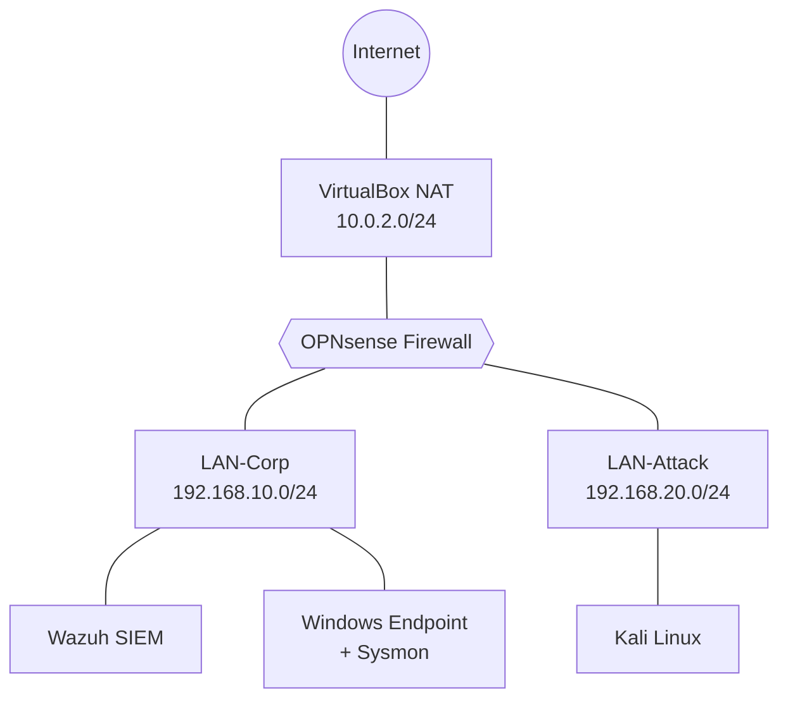

# 🛡️ Home SOC Lab

A self-built Security Operations Centre lab for hands-on detection engineering,
threat hunting and incident response practice. Every attack simulation is mapped
to the **MITRE ATT&CK** framework and documented with a full incident report.

> **Status:** 🟡 Phase 3 in progress (Windows endpoint + Sysmon)

---

## 🎯 Objectives
- Build a segmented enterprise-style network using free, open-source tooling
- Centralise endpoint and network telemetry into a SIEM
- Simulate real adversary techniques and detect them from logs
- Produce professional SOC incident reports for each investigation

## 🧰 Tech Stack
| Layer            | Tool                        | Purpose                              |
|------------------|-----------------------------|--------------------------------------|
| Hypervisor       | Oracle VirtualBox (Type 2)  | Hosts all lab VMs                    |
| Firewall/Router  | OPNsense                    | Segmentation, routing, firewall logs |
| SIEM / XDR       | Wazuh (all-in-one)          | Log collection, detection, alerting  |
| Endpoint         | Windows 11 + Sysmon         | Victim host with rich telemetry      |
| Adversary        | Kali Linux                  | Attack simulation                    |

## 🗺️ Network Topology


## 🚧 Build Roadmap
| Phase | Milestone                                   | Status |
|-------|---------------------------------------------|--------|
| 0     | Host preparation & capacity planning        | ✅     |
| 1     | OPNsense firewall & network segmentation    | ✅     |
| 2     | Kali Linux attacker VM & ATTACK rules       | ✅     |
| 3     | Windows endpoint + Sysmon                   | 🟡     |
| 4     | Wazuh SIEM deployment & agent enrolment     | ⬜     |
| 5     | Firewall log forwarding to SIEM             | ⬜     |
| 6     | Attack simulations & incident reports       | ⬜     |

## 📁 Repository Structure
```
home-soc-lab/
├── README.md
├── docs/
│   ├── 00-host-preparation.md
│   ├── 01-network-architecture.md
│   ├── 02-opnsense-build.md
│   ├── 03-kali-attack-lane.md
│   └── troubleshooting/
│       └── TS-001-dhcp-attack-segment.md
├── configs/            # Exported configs (sanitised)
├── detections/         # Custom rules & queries
├── incident-reports/   # One report per simulated attack
└── screenshots/
```

## 💻 Lab Host
| Component | Specification                          |
|-----------|----------------------------------------|
| Laptop    | ASUS TUF Gaming F15 (FX506LH)          |
| CPU       | Intel Core i5-10300H (4C/8T, VT-x)     |
| RAM       | 8 GB → upgrade to 24 GB planned        |
| Storage   | 512 GB NVMe (~200 GB allocated to lab) |

**Capacity note:** The Wazuh all-in-one stack needs ~8 GB RAM on its own. The
firewall and attacker tiers are being built first; SIEM deployment follows the
planned RAM upgrade.

---
*All activity is confined to an isolated virtual lab. No techniques are used
against systems I do not own.*
