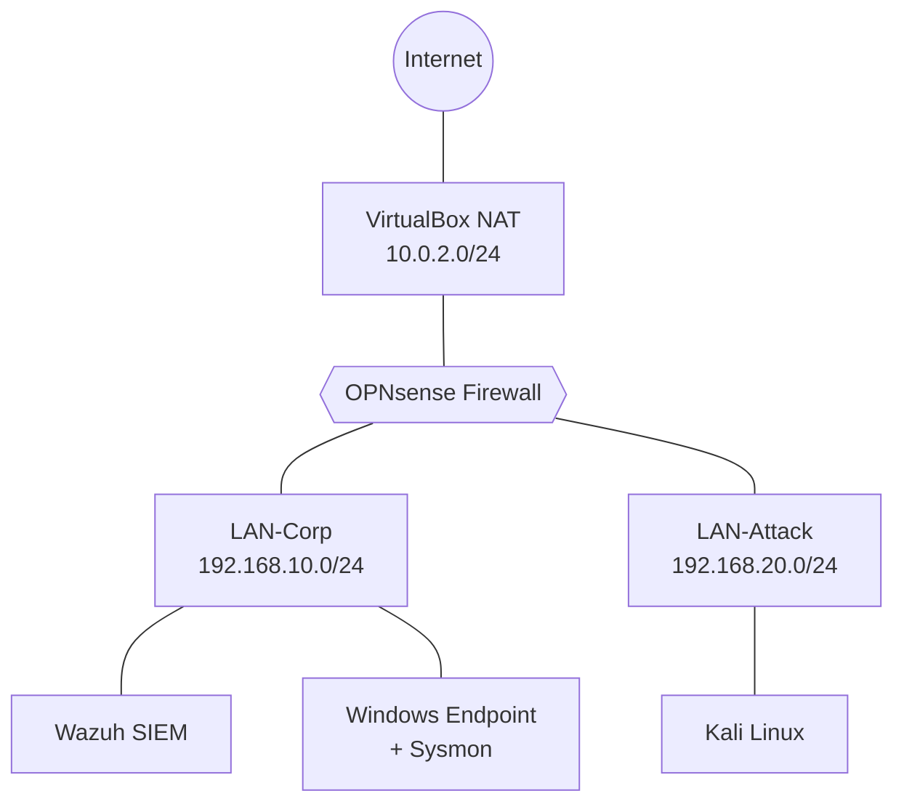

# 01 — Network Architecture

## Overview
A segmented virtual network built on VirtualBox, with OPNsense acting as the
central firewall/router. All traffic between the attacker and corporate segments
is forced through the firewall, ensuring it is logged and inspectable.

## Topology


## Addressing Plan
| Segment    | Subnet           | Gateway       | DHCP Range                      | Purpose                     |
|------------|------------------|---------------|---------------------------------|-----------------------------|
| WAN        | 10.0.2.0/24      | 10.0.2.2      | Issued by VirtualBox NAT        | Internet access             |
| LAN-Corp   | 192.168.10.0/24  | 192.168.10.1  | 192.168.10.100 – 192.168.10.200 | Simulated corporate network |
| LAN-Attack | 192.168.20.0/24  | 192.168.20.1  | 192.168.20.100 – 192.168.20.200 | Isolated adversary segment  |

## Traffic Path to Internet (Double NAT)
```
Lab host → OPNsense (NAT) → VirtualBox NAT → Home router (NAT) → Internet
```
Investigative note: the OPNsense WAN address (10.0.2.15) represents the firewall's
outside interface, not an end host. Attribution of outbound traffic to an internal
host requires the firewall's NAT/state logs.

## Design Decisions
- **Segmentation:** The attacker is isolated on its own segment so every attack
  must traverse the firewall, generating network telemetry.
- **Non-overlapping subnets:** Lab ranges avoid VirtualBox's default NAT range
  (10.0.2.0/24) to prevent routing conflicts.
- **Containment:** VirtualBox NAT permits outbound traffic only; the home network
  cannot initiate connections into the lab.
